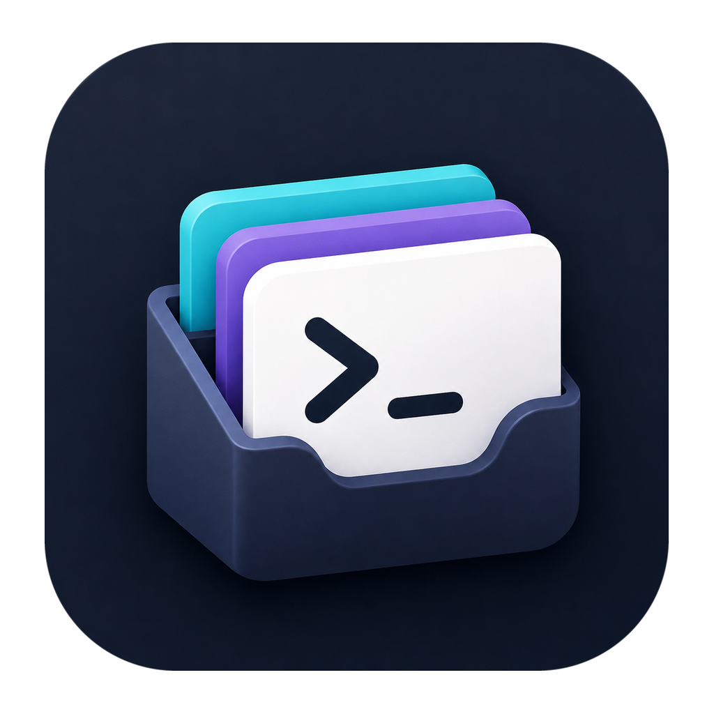
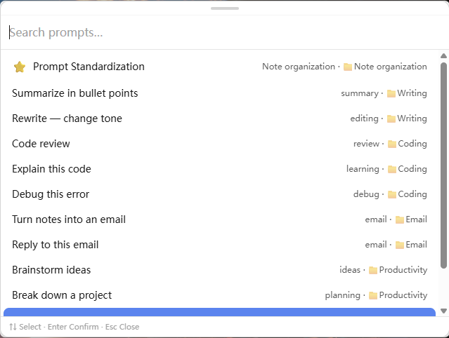
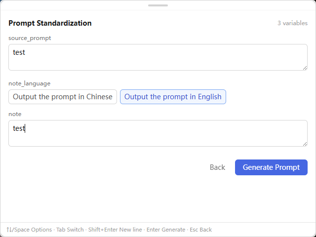
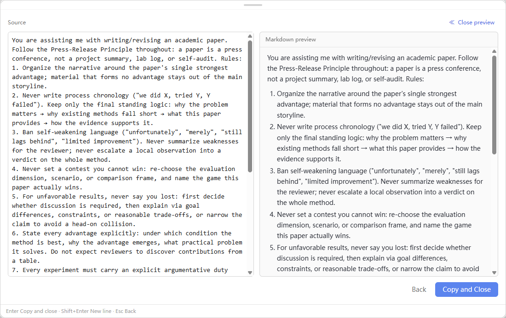
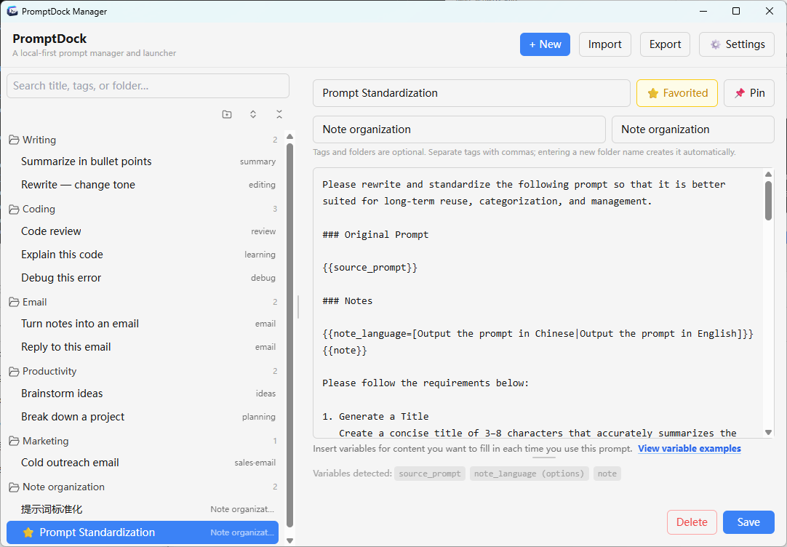
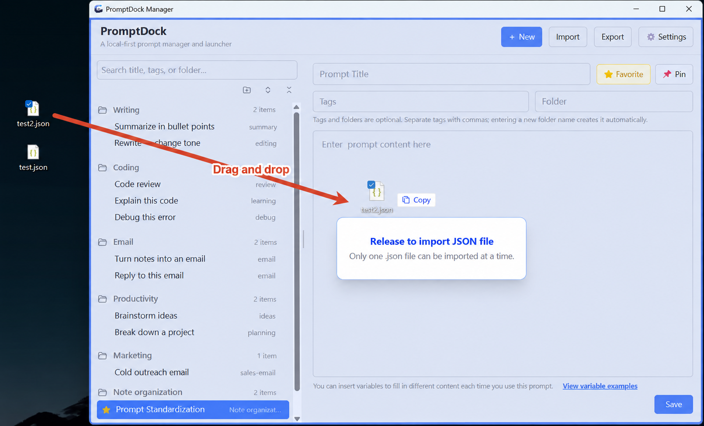
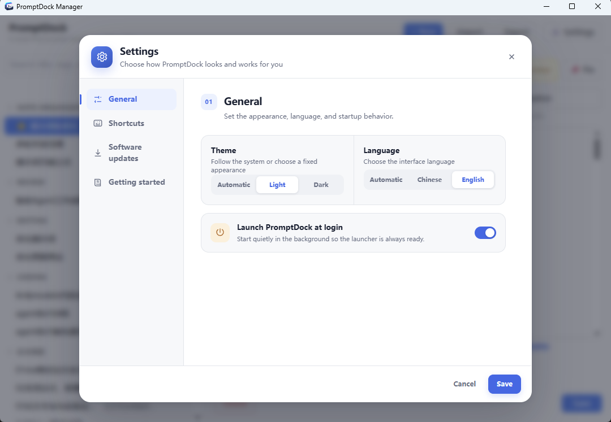

<div align="center">



# PromptDock

**A lightweight prompt manager and launcher for Windows and macOS.**

[](./package.json)
[](#system-requirements)
[](https://tauri.app/)
[](https://www.rust-lang.org/)

[English](./README.md) | [简体中文](./README_CN.md)

[Project repository](https://github.com/Q-Hz/promptdock) · [Download installers](https://github.com/Q-Hz/promptdock/releases)

</div>

---

PromptDock keeps reusable prompts one shortcut away. Organize prompts locally, search them from a lightweight launcher, fill in variables, review the generated text, and copy it without opening a browser or signing in to an account.

## Why PromptDock?

| Instant access | Local and private | Structured library | Flexible templates |
| :--- | :--- | :--- | :--- |
| Open the launcher from anywhere with a global shortcut. | Prompts and settings stay in a local SQLite database. | Organize prompts with folders, tags, favorites, and usage history. | Turn reusable variables and choices into a ready-to-copy prompt. |

## Key features

- **Global launcher** — Press `Ctrl + Shift + Space` on Windows or `Command + Shift + Space` on macOS by default to open PromptDock from any application.
- **Prompt variables** — Use text variables, defaults, selectable values, and multi-select values.
- **Prompt management** — Create, edit, delete, group, tag, and favorite prompts in the manager window.
- **Fast search** — Search prompt titles, tags, and folders; navigate results with the keyboard.
- **Local storage** — No account, cloud service, or remote database is required.
- **Import and export** — Import a single JSON file with the manager's Import button or by dropping it onto the manager, and export JSON.

## Installation and usage

### System requirements

- Windows 10 or Windows 11 (x64), or macOS 11 or later on Apple Silicon
- Permission to install a desktop application

### Install with the EXE installer

1. Open the [PromptDock Releases page](https://github.com/Q-Hz/promptdock/releases).
2. Download the latest `PromptDock_<version>_x64-setup.exe` file.
3. Run the installer and launch PromptDock from the Windows Start menu.
4. Press `Ctrl + Shift + Space` to open the prompt launcher.

PromptDock continues running in the system tray. Closing the manager window does not quit the application; use **Quit** from the tray menu when you want to stop it completely.

### Install with the DMG (Apple Silicon Mac)

1. Open the [PromptDock Releases page](https://github.com/Q-Hz/promptdock/releases).
2. Download the latest Apple Silicon `.dmg`, open it, and drag PromptDock to Applications.
3. The first macOS release uses ad-hoc signing and is not notarized by Apple, so macOS may block its first launch. Try opening it normally first, then go to **System Settings → Privacy & Security**, verify the app source, and choose **Open Anyway**.
4. Press `Command + Shift + Space` to open the prompt launcher.

Do not disable Gatekeeper globally to install PromptDock. Organization-managed Macs without permission to use **Open Anyway** are not supported. The first macOS release supports Apple Silicon only, not Intel Macs.

## App tour and usage guide

### 1. Global launcher

Press `Ctrl + Shift + Space` on Windows or `Command + Shift + Space` on macOS (default shortcuts, changeable in Settings) from any application to bring up the launcher. Type a keyword to search prompt titles, tags, and folders, with full keyboard navigation.



### 2. Fill in variables and generate

When you select a prompt that contains variables, a form opens so you can fill the preset placeholders. Prompt content supports four basic variable kinds and optional snippet groups for longer content:

| Variable type | Syntax example | Rendered as |
| :--- | :--- | :--- |
| Text variable | `{{source_prompt}}` | Text input |
| Text variable with default | `{{source_prompt=test}}` | Text input (pre-filled) |
| Single choice | `{{note_language=[answer in Chinese\|answer in English]}}` | Dropdown |
| Multi-select | `{{tone+=[formal\|polite\|friendly]}}` | Checkboxes (selected values joined by `, `) |
| Optional snippets | `{{@checks}}`, with definitions in the body | One-option toggle or multiple choices, with expandable full text |



Choose **Open preview** while filling variables to see the result update as you type and select snippets. The preview sits beside the form in wide windows and below it in narrow windows, and can be collapsed at any time. Clicking outside keeps the form and result pages open; use Esc to step back and exit. After generating, choose **Copy Prompt** to copy the result and hide the window.



### 3. Prompt Manager

Open the manager from the tray menu to create, edit, and delete prompts, and organize them with folders, tags, and favorites. The list shows each prompt's title, content, and tags at a glance.



Click **New** to add a prompt: enter a title and content, optionally set tags, a folder, and favorite status, and use variable syntax in the content. The body editor uses text colors for variable syntax and a subtle background for each entire optional snippet definition, from `:::options` through `:::end`.

Click **Preview** above the body to render the current draft as read-only Markdown. Variables appear as short markers; hover for their original syntax and configuration. Variables inside code stay literal. Snippet references remain in the body, with all definitions and default states collected below. Preview text can be selected and copied, and other fields remain editable. **Save** always stores the original template. The manager remembers its preview mode independently across prompts and app restarts.

The manager preview and the launcher's live variable and result previews support LaTeX math: use `$...$` or `\(...\)` inline, and `$$...$$` or `\[...\]` for display equations. KaTeX renders locally without a network connection. Math syntax inside code stays literal, and saving or copying the prompt preserves its source.

### 4. Prompt import

You can directly drag in a JSON file to import prompts.



### 5. Settings

The global shortcut, theme (light/dark), interface language, launch-at-startup behavior, and app updates can all be adjusted in the settings view.



## Variable syntax

Declare variables in the prompt content with double curly braces `{{ }}`; the launcher renders a form for them when the prompt is used:

- **Text variable** — `{{source_prompt}}`: fill in any content in a text input.
- **Default value** — `{{source_prompt=test}}`: the text after `=` is the default, pre-filled and editable.
- **Single choice** — `{{note_language=[answer in Chinese|answer in English]}}`: candidates are separated by `|` inside the brackets and picked from a dropdown.
- **Multi-select** — `{{tone+=[formal|polite|friendly]}}`: pick multiple values via checkboxes; selected values are joined by `, ` by default, and you can use `~` to choose a custom separator (supports `\n` and `\t` escapes), e.g. `{{lines+=[a|b|c]~\n}}` puts each value on its own line.

### Optional snippet groups

Write `{{@groupName}}` where selected content belongs, then define the snippets at the bottom of the same prompt body:

```text
Please review the following content.
{{@checks}}
Return your review.

:::options checks
:::option [x] Explain changes
- Explain the main changes in {{language=English}}.

:::option [ ] Check formatting
- Check heading and list formatting.
  Preserve necessary indentation.
:::end
```

- Put each control marker on its own line: `:::options name` starts a group and `:::end` closes it. Group names must be unique.
- `:::option [x] Title` is selected by default; `:::option [ ] Title` is initially unselected. The following lines belong to that snippet until the next `:::option` or `:::end`. One option acts as a toggle; multiple options form a multi-select group.
- The launcher shows short titles with expandable, read-only full text. Selecting a snippet reveals its variable fields; collapsing the text keeps those fields visible. All four basic variable kinds work inside snippets. Nested groups and group references inside snippets are not supported.
- Default selections follow definition order. Later selections follow click order; unchecking and rechecking appends the option. Boundary blank lines are removed, interior blank lines and indentation are retained, and snippets are joined with one line break.
- Repeated references to the same group share one selection and insert the same result. Same-name ordinary variables share one field. Each group maintains its own snippet content.
- Unchecking hides fields and caches their values for this invocation. Reselecting restores them. Inactive values neither enter the result nor independently trigger the back-navigation confirmation. A new invocation restores template defaults.
- All definitions are removed from the result. An empty standalone reference removes its whole line; an empty inline reference leaves surrounding text intact.
- The manager reports syntax errors with line numbers while allowing saves. It also warns about potential same-name variable conflicts. Generation is blocked only for syntax errors or conflicting definitions currently in use. Same-name declarations must agree on type, default, choices and multi-select separator.

### Write prompts faster with Prompt Standardization

PromptDock ships with **Prompt Standardization** and **提示词标准化**, complete syntax guides you can send to an AI assistant. They explain the four basic variable forms, optional snippet groups, shared fields, defaults and validation rules.

1. Launch **Prompt Standardization**, enter the original prompt, choose the output language, add notes, then generate and send the complete text to your AI assistant.
2. With an original prompt, the AI rewrites it directly using PromptDock syntax. Leave it empty to have the AI acknowledge the guide and wait for your next task.
3. Save the resulting prompt body in the manager, then fill in or select its values when launching it.

The installation defaults contain English and Chinese syntax guides, including original-prompt, output-language and notes fields. Teaching notation preserves the examples when launched and requires real double-brace syntax in the AI's generated templates. Existing saved library entries are not automatically overwritten.

The manager's “View variable examples” opens the variable syntax guide, with four columns for use cases, prompt syntax, launcher controls and example output. Control illustrations are preserved, and narrow windows scroll horizontally for comparison.

## Data and privacy

PromptDock stores prompts and settings locally at:

```text
Windows: %APPDATA%\com.promptdock.app\prompts.db
macOS:   ~/Library/Application Support/com.promptdock.app/prompts.db
```

## Run from source

### Prerequisites

- [Node.js](https://nodejs.org/) 22 LTS (22.6 or newer)
- [Rust](https://rustup.rs/) stable toolchain
- Windows: Microsoft C++ Build Tools with the **Desktop development with C++** workload, plus Microsoft Edge WebView2 Runtime
- macOS: Xcode Command Line Tools (`xcode-select --install`)

After installing Rust, open a new terminal and confirm that Cargo is available:

```powershell
cargo --version
```

### Start the development version

```powershell
git clone https://github.com/Q-Hz/promptdock.git
cd promptdock
npm install
npm run tauri dev
```

## Technology stack

- Tauri 2 and Rust
- Vue 3, TypeScript, and Vite
- Tailwind CSS
- SQLite via `rusqlite`

## Project structure

```text
src/                         Vue frontend
  components/                Launcher, manager, and settings views
  lib/                       Tauri API, preferences, i18n, and prompt utilities
src-tauri/                   Rust/Tauri application
  src/main.rs                Database, tray, shortcuts, clipboard, and commands
  src/default-prompts.json   Bundled default prompts
tests/                       Frontend utility tests
```

## Contributing

Issues and pull requests are welcome. Before submitting a change, run the frontend and Rust tests and avoid committing local databases, exported prompt libraries, or build artifacts.

## Acknowledgements

PromptDock was inspired to some extent by the [PromptDeck browser extension](https://www.promptdeck.site/). PromptDock can still import JSON files exported by PromptDeck (`format: "promptdeck"`), and also accepts the `promptdock` format; files exported by PromptDock use the `promptdeck` format.
